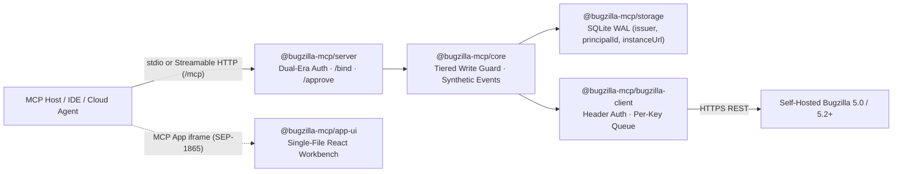

# `bugzilla-mcp`

Production-hardened, dual-mode (**Cloud Autonomous Agent** + **Local IDE / Antigravity**) **Model Context Protocol (MCP) Server** for self-hosted **Bugzilla 5.0 / 5.2+**, built with TypeScript, **Bun**, and **VoidZero (`vite-plus`)**.

## Protocol & Spec Alignment

- **MCP Core `2026-07-28`** (+ `2025-11-25` Dual-Era session compatibility with tenant-bound sessions)
- **MCP Apps (`SEP-1865`)** single-file React workbench (`ui://bugzilla/triage-app.html`) & inline dossier card (`ui://bugzilla/dossier-card.html`)
- **MCP Events (`SEP-3415` + ChatGPT Events dialect adapter)** with lag-windowed cursors & SSRF-hardened DNS-pinned Standard Webhooks

## Architecture Overview



## Key Safety Properties

- **Zero API Key in LLM Context**: Bugzilla API keys are collected via out-of-band `/bind` HTTPS forms (cloud) or environment variables (local), stored with AES-256-GCM AAD bound to `(issuer, principalId, instanceUrl)`, and never emitted into prompts, logs, or URLs by default.
- **Tiered Write Guard**:
  - **Safe-Auto (`bugzilla_post_analysis`)**: Strictly `isPrivate: true`; fails closed to a server-local internal note (`SavedAsInternalNote`) when the user is not an insider or upstream rejects private comments—never degrades to a public comment.
  - **Guarded-Write (`bugzilla_propose_update` / `app_resolve_proposal`)**: Optimistic `last_change_time` freshness verification (`StaleBugConflict` requires a new immutable revision), single-use issuer-bound cloud `/approve` tokens, and immutable write audits.
- **Multi-Issuer Tenant Isolation (`[R-970164]`)**: Every tenant-scoped SQLite table, event cursor, approval token, legacy HTTP session, and MCP App draft cache is partitioned by `(issuer, principalId, instanceUrl)`.

## 5-Minute Quick Start (Local IDE `stdio`)

```bash
bun install
bun run build:ui
```

Add to your MCP client configuration (Antigravity, Claude Desktop, Cursor, etc.):

```json
{
  "mcpServers": {
    "bugzilla": {
      "command": "bun",
      "args": ["run", "/ABS/PATH/TO/bugzilla-mcp/packages/server/src/cli.ts", "--transport=stdio"],
      "env": {
        "BUGZILLA_BASE_URL": "https://bugzilla.example.internal",
        "BUGZILLA_API_KEY": "<your-bugzilla-api-key>",
        "BUGZILLA_DB_PATH": "/ABS/PATH/TO/bugzilla-mcp.sqlite"
      }
    }
  }
}
```

> **Stock Bugzilla 5.0 / 5.2 note**: Stock Bugzilla 5.0/5.2 without a reverse-proxy header rewrite or 5.3+ patch ignores `X-BUGZILLA-API-KEY`. Set `BUGZILLA_ALLOW_QUERY_FALLBACK=true` **only** if your Apache/Nginx access logs strip query strings (`%U` instead of `%r`). See [docs/security-and-operations.md](docs/security-and-operations.md).

## Documentation Map

| Guide                                                              | Purpose                                                                                                       |
| :----------------------------------------------------------------- | :------------------------------------------------------------------------------------------------------------ |
| [docs/quickstart-and-clients.md](docs/quickstart-and-clients.md)   | Local `stdio`, Loopback HTTP, and programmatic Cloud Multi-User embedding (`startMcpHttpServer`)              |
| [docs/reference.md](docs/reference.md)                             | Environment variables, CLI flags, all 11 MCP tools, resources, events, webhooks, and HTTP routes              |
| [docs/security-and-operations.md](docs/security-and-operations.md) | Threat model, Bugzilla 5.0/5.2 quirks & proxy checklist, SQLite pre-v3 migration runbook, and troubleshooting |
| [specs/](specs/)                                                   | Frozen contract-driven specifications (`25` stamped `[R-xxxxxx]` EARS clauses) & Quint formal models          |

## Workspace Packages

| Package                                                | Responsibility                                                                                                                                                                         |
| :----------------------------------------------------- | :------------------------------------------------------------------------------------------------------------------------------------------------------------------------------------- |
| [`packages/contracts`](packages/contracts)             | Strict Zod schemas, `RESERVED_LEGACY_ISSUER`, and TypeScript contracts (`C0 v3`)                                                                                                       |
| [`packages/storage`](packages/storage)                 | `StoragePorts` + SQLite (`node:sqlite` WAL) with `(issuer, principalId, instanceUrl)` partitioning & atomic pre-v3 migration                                                           |
| [`packages/bugzilla-client`](packages/bugzilla-client) | Self-hosted Bugzilla REST client (header auth default, explicit `allowQueryFallback`, per-key serial queue avoiding MariaDB `user_api_keys.last_used` deadlocks, error classification) |
| [`packages/core`](packages/core)                       | Tiered Write Guard, issuer-bound single-use cloud approval tokens, SSRF-hardened DNS-pinned Standard Webhooks, and Synthetic Events engine                                             |
| [`packages/app-ui`](packages/app-ui)                   | Sanitization & host controller + single-file React/Vite+ MCP App UI (`tenantKey` isolation, `<= 4` unified concurrency gate, native `<dialog>` confirmations)                          |
| [`packages/server`](packages/server)                   | Dual-Era Streamable HTTP handler, `/bind` & `/approve` pages, AES-256-GCM credential vault, loopback-guarded HTTP runtime, and `stdio` transport                                       |

## Verification & Quality Gates

```bash
bun run build:ui        # Build single-file MCP App HTML (packages/app-ui/dist-web/triage-app.html)
bun run check           # Format + Oxlint (vite-plus)
bun run typecheck       # Type-check all 6 packages + React web bundle
bun run typecheck:tests # Type-check test suite
bun run test            # Contract & multi-issuer isolation suite (82 tests, 25/25 clauses)
bun run verify:quint    # Quint formal safety invariants (write_guard + events_ingestion)
```

### Live Bugzilla 5.2 Zero-Mock E2E (Docker / OrbStack)

```bash
cd docker/bugzilla && docker compose up -d --build --wait
cd ../.. && bun run test:e2e
# Tear down temporary Bugzilla when done:
cd docker/bugzilla && docker compose down -v
```
