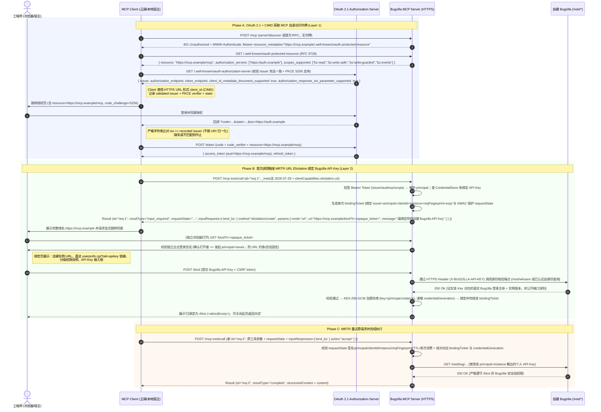

# 云端 OAuth 2.1 (CIMD) 与 URL Elicitation 凭据绑定设计

> 上游基线：[brief.md](./brief.md) · [architecture-and-contracts.md](./architecture-and-contracts.md)
> 关联契约：`R-16ad61` · `R-221a18` · `R-0953f3` · `R-0bfd0f`

## 1. 设计目标与产品原则

云端多用户模式下，首次冷启动体验（30 秒内完成授权并开始干活）与安全边界（企业自建 Bugzilla API Key 绝不经由 LLM / MCP Client 泄露）往往互相冲突。本设计遵循以下产品与协议原则：

- **保护用户“好感水库”（Krug's Reservoir of Goodwill）**：首次绑定不让用户到处找路径、不问多余信息、不藏权限说明。绑定页直接提供自建 Bugzilla 的 `userprefs.cgi?tab=apikey` 深链、1 步粘贴校验、立即回显“已验证为 `<real_name>`（只读/分级写权限）”，并提供一键撤销入口 [source: work/product-design/dont-make-me-think-revisited-3rd-ed.md | as-of: 2014 (3rd ed.)]。
- **降低冷启动阻力（Cold-Start Friction）**：将“MCP Server 身份认证（OAuth 2.1）”与“上游 Bugzilla 凭据绑定（URL Elicitation）”拆成清晰的两次短动作；后续所有对话与 Webhook 订阅无缝复用，不再打扰。
- **凭据最小暴露面（Zero-Transit Principle）**：严格遵守 MCP `2026-07-28` 规范——**绝不用 `elicitation` 表单模式索取 API Key**，第三方凭据绝不经过 MCP Client 或模型上下文，仅由用户在独立浏览器中直交 MCP Server 的受控 HTTPS 页面加密落库 [source: work/mcp/core-2026-07-28/specification/client/elicitation.mdx | as-of: 2026-11-18]。

## 2. 两层鉴权边界模型（绝不混用）

| 层次 | 解决什么问题 | 采用机制 | 令牌/凭据流向 |
| :--- | :--- | :--- | :--- |
| **Layer 1：Client → MCP Server** | 识别“谁在调用 MCP Server”及允许调用哪些 MCP 能力 | **OAuth 2.1 + RFC 9728 Protected Resource Metadata + CIMD**（优先预注册/CIMD，不新做已弃用的 DCR） | `Authorization: Bearer <mcp_token>` 仅用于 MCP Server 自身鉴权（校验 `aud`/`resource`），**严禁透传给 Bugzilla** [source: work/mcp/core-2026-07-28/specification/basic/authorization/security-considerations.mdx | as-of: 2026-11-18] |
| **Layer 2：MCP Server → 自建 Bugzilla** | 以该用户的真实 Bugzilla 身份与安全组权限访问自建实例 | **MRTR (`resultType: "input_required"`) + `elicitation/create` (`mode: "url"`)** 引导至独立 HTTPS 绑定页 | 用户将个人 Bugzilla API Key 直接提交给 MCP Server 绑定页；Server 用 `KMS / AES-256-GCM` 按 `principal` 加密存储，绝不回传给 Client |

> **关键区分**：本地模式（stdio / localhost）跳过 Layer 1 与 Layer 2 绑定页，直接读取环境变量 `BUGZILLA_API_KEY`，零额外摩擦。

## 3. 完整协议时序图（OAuth 2.1 + CIMD → MRTR URL Elicitation → Bugzilla 凭据落库）

## 4. 防钓鱼、防重放与安全红线（规范陷阱核对）

基于 MCP `2026-07-28` 规范与已知陷阱，下列 6 条必须在实现期作为硬性安全红线核查：

1. **禁止在现代路径混用 `2025-11-25` 旧字段**：`2026-07-28` 已移除 `elicitationId` 和 `notifications/elicitation/complete`，现代请求统一使用 **MRTR `requestState` + 新 `id` 重试**关联带外完成态，且客户端放弃重试时服务端靠短时 TTL（`<= 10 min`）自然过期释放票据 [source: work/mcp/core-2026-07-28/specification/changelog.mdx | as-of: 2026-11-18]。Dual-Era 面对 `2025-11-25` 旧客户端时走独立 legacy 适配分支（`elicitationId` / `-32042` URL-required 流程），绝不向 legacy 客户端返回现代 `input_required`。
2. **必须验证“打开绑定页的人 == 发起请求的 `principal`”且精确匹配票据上下文**：URL `accept` 仅代表用户同意打开链接，**不代表绑定已完成**；`bindingTicket` 必须绑定 `(issuer, principal, clientId, instanceUrl, reqFingerprint, credentialGeneration)`，且在 `GET /bind` 与 `POST /bind` 两次核验企业 SSO 会话主体与发起者一致，杜绝并行多票据错绑或跨客户端劫持 [source: work/mcp/core-2026-07-28/specification/client/elicitation.mdx | as-of: 2026-11-18]。
3. **`requestState` 完整性与单次消费**：`requestState` 视作不可信输入，必须做 HMAC/AEAD 完整性保护并绑定 `(issuer, principal, clientId, toolName, paramsHash, exp <= 10min)`；涉及凭据切换或写操作的 MRTR 重试必须在服务端持久化单次消费标记（at-most-once）[source: work/mcp/core-2026-07-28/specification/basic/patterns/mrtr.mdx | as-of: 2026-11-18]。
4. **OAuth Issuer Mix-Up、CIMD 校验与 PKCE 防护**：Client 与 AS 必须验证元数据 `issuer` 精确一致、CIMD HTTPS 文档 `client_id` 与 URL 完全相等且重定向 URI 精确注册（防 SSRF）、强制 `PKCE S256` 支持与校验、对回调 `iss` 做无归一化精确字符串比对（本部署 AS 声明 `authorization_response_iss_parameter_supported: true`，缺失 `iss` 必须拒绝），并按 AS `issuer` 隔离凭据与公开客户端 refresh token 轮转 [source: work/mcp/core-2026-07-28/specification/basic/authorization/index.mdx | as-of: 2026-11-18]。
5. **CIMD Loopback 冲突规避 & 本地 HTTP 边界**：生产云端重定向 URI 仅允许 **HTTPS**；本地开发显式采用 `http://localhost:<port>/callback`（避开规范示例 `127.0.0.1` 与正文 `localhost` 的歧义）[source: work/mcp/core-2026-07-28/specification/basic/authorization/security-considerations.mdx | as-of: 2026-11-18]。本地 Streamable HTTP 模式仅监听 loopback、强制校验 `Host`/`Origin` 与每安装随机本地令牌（或仅使用 `stdio`）。
6. **最小权限 Step-Up & 云端 Guarded 审批凭证**：统一 Scope 词表为 `bz:read`、`bz:write:safe`、`bz:write:guarded`、`bz:events`。权限不足时返回 `HTTP 403` + `WWW-Authenticate: Bearer error="insufficient_scope", scope="<最小所需全集>", resource_metadata="https://mcp.example/.well-known/oauth-protected-resource"` [source: work/mcp/core-2026-07-28/specification/basic/authorization/index.mdx | as-of: 2026-11-18]。**云端 Guarded-Write 人工审批**严禁仅凭 MCP App `visibility: ["app"]` 认定，必须经由服务端独立认证的 HTTPS `/approve?t=<approvalTicket>` 页面签发一次性审批凭证，绑定 `(approver, instance, proposalId, revision, canonicalDiffHash, baseVersion, visibility, exp)`；本地可信 IDE 模式则明确标注为“宿主确认信任边界”。
7. **API Key 零日志泄露**：优先通过 HTTPS Header（`X-BUGZILLA-API-KEY`）向已验证 Origin 的自建 Bugzilla 鉴权；禁止用公开端点（如 `/rest/version`）冒充身份核验，禁止将 API Key 写入查询串日志、链路追踪、URL 重定向、MCP 响应或模型上下文（老版本 5.0 若不支持非 URL 凭据且未配置经审计的隔离代理，默认 Fail-Closed 拒绝）。

## 5. 异常与恢复矩阵（保护用户 Goodwill）

| 异常场景 | 服务端可观测行为 | 给用户/Agent 的明确下一步 |
| :--- | :--- | :--- |
| 用户在弹窗点 `decline` 或 `cancel` | 立即终止该次工具调用，释放 `bindingTicket`，返回温和的 `isError: true` 结构化提示（绝不静默重试循环弹窗） | 告知用户“未绑定 Bugzilla API Key，暂无法查询私有缺陷；随时可重新触发绑定” |
| 用户点 `accept` 打开链接但尚未提交 Key，Client 就发起重试 | 查库见 `bindingTicket` 仍为 `pending`，再次返回 `InputRequiredResult`（附清晰文案“绑定尚未完成，请在已打开页面提交 Key 后点击重试”）[source: work/mcp/core-2026-07-28/specification/client/elicitation.mdx | as-of: 2026-11-18] | 客户端展示手动 Retry / Cancel 按钮，不死循环 |
| 客户端不支持 `elicitation.url`（如部分无头云端 Agent） | 不发送 `elicitation/create`，直接返回结构化错误 `CredentialBindingRequired` + 管理员/用户自助绑定入口说明 | 引导用户在工作区集成设置页提前绑定一次 API Key |
| 粘贴的 Bugzilla API Key 无效或自建 Bugzilla 不支持安全 Header 认证 | 绑定页仅使用已认证身份核验调用（如 `/rest/whoami` 或受认证自身份检查，不误将 `/rest/version` 当作 Key 有效证据）；若实例不支持 Header 认证且未显式开启受控兼容通道则 Fail-Closed 拒绝，行内标红具体原因 | 不清空表单，不抛 500，给出 1 句可执行排查建议 |
| 运行中途用户在 Bugzilla 侧撤销了 API Key | 工具调用返回 `CredentialRevoked`（或触发新的 URL Elicitation 重绑）；该用户的活跃事件订阅按 `R-0bfd0f` 自动发送 `terminated` 并停止投递 | 自动止血，避免后台轮询持续打爆 Bugzilla 鉴权日志 |
