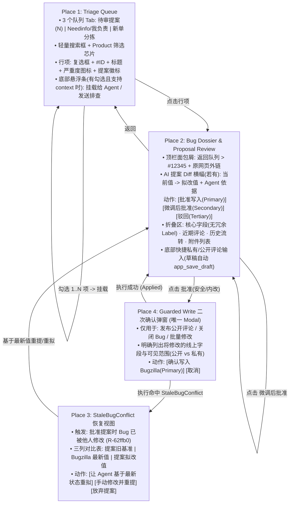

# MCP App（Triage 看板与审批工作台）交互与视觉设计规范

> 上游基线：[brief.md](./brief.md) · [architecture-and-contracts.md](./architecture-and-contracts.md)
> 目标包：`packages/app-ui`（SEP-1865 `@modelcontextprotocol/ext-apps` 单文件 HTML）

## 1. 遵循的产品与界面设计原则

本 MCP App 不复刻传统 Bugzilla 繁杂的网页表单，而是吸收三套成熟设计体系的实战原则：

1. **Don't Make Me Think（Steve Krug）**
   - **扫描优先，而非阅读（Design for Scanning）**：工程师打开侧边栏只花 2 秒扫一眼“有哪些需要我处理”，每行卡片只保留 3 个核心信号（`#BugID` + 标题 + 关键状态/待审标签），砍掉所有装饰性套话（Krug 第三定律）[source: work/product-design/dont-make-me-think-revisited-3rd-ed.md | as-of: 2014 (3rd ed.)]。
   - **清晰胜于死板一致（Clarity Trumps Consistency）** + **侧边栏版 Trunk Test**：任何时候眯眼看面板，必须一眼分辨 4 个锚点——当前连接的 Bugzilla 实例、所在队列（You are here）、搜索/筛选入口、以及正在操作的 Bug 编号 [source: work/product-design/dont-make-me-think-revisited-3rd-ed.md | as-of: 2014 (3rd ed.)]。
   - **明确且无歧义的动作（Krug 第二定律）**：区分“挂载给 Agent 看（`updateModelContext`）”、“立即发消息让 Agent 查（`sendMessage`）”与“写入 Bugzilla（`Approve`）”三种动作的视觉权重与文案，绝不让用户猜“点了会不会直接改线上 Bug”。
2. **Shape Up（Ryan Singer）**
   - **先 Breadboard，再粗笔线框（Fat Marker）**：先定清 Places（页面/视图）、Affordances（可操作控件）与 Connections（流转箭头），避免过早陷入像素装饰而漏掉核心异常路径 [source: work/product-design/shape-up.md | as-of: 2019 (PDF 2021-04-21)]。
   - **窄画布优先（Mobile/Pane-First ~400px）**：先为 IDE 侧边栏（`aux_pane`）把单列体验做到极致，再在全屏（`global`）自然展开为双栏列表+详情 [source: work/product-design/refactoring-ui.md | as-of: 2018]。
3. **Refactoring UI（Adam Wathan & Steve Schoger）**
   - **层级靠字重与对比度，而不是满屏边框**：用背景层次、间距（组外大于组内）与两档字重（400/500 正文 + 600/700 标题）区分主次，杜绝“卡片套卡片 + 四周粗线框”的 AI 模板味 [source: work/product-design/refactoring-ui.md | as-of: 2018]。
   - **动作层级与破坏性按钮克制**：一屏只保留 1 个高对比主按钮（Primary Solid）；次要动作给描边/低对比（Secondary）；破坏性动作（如 Reject/关单/发公开回复）在列表页克制弱化，仅在二次确认卡中升格为红底主按钮 [source: work/product-design/refactoring-ui.md | as-of: 2018]。
   - **非纯色提示与高质量空态**：优先级/严重度/冲突状态不能只靠颜色区分，必须搭配语义图标或短文字标签；空态时隐藏无效的筛选栏与 Tab，给出清晰的下一步动作 [source: work/product-design/refactoring-ui.md | as-of: 2018]。

## 2. 多宿主表面适配矩阵（Inline / Aux Pane / Global / 无 UI 宿主）

MCP App 运行在多种宿主表面，**能力与入口语义差异极大**。特别注意：在 Antigravity 中，声明了 `aux_pane` / `global` 入口的工具**不会同时以 Inline 渲染**；因此必须将 **看板队列工具**（`bugzilla_triage_board` → `aux_pane` + `global`）与 **单 Bug 内联卡工具**（`bugzilla_get_dossier` → 仅 `inline`，不声明 `aux_pane`）拆分为独立工具；且对不支持 MCP Apps 的 CLI / 纯文本宿主提供完备的文本回退（`content`）。

| 维度 | `aux_pane`（主力：`bugzilla_triage_board`） | `global`（全屏：`bugzilla_triage_board`） | `inline`（单卡：`bugzilla_get_dossier`） | 无 UI 宿主（CLI / 云端无头） |
| :--- | :--- | :--- | :--- | :--- |
| **典型尺寸** | 360px ~ 480px，高度填满 | >= 900px，高度填满 | 对话列宽，自动调高（上限 **800px**） | 纯文本 + `structuredContent` |
| **布局形态** | 单列队列 → 点击滑入详情抽屉 | 双栏 Master-Detail（左 360px 队列 + 右弹性详情） | 单 Bug 紧凑摘要与提案状态卡 | 结构化 Markdown 摘要 |
| **空参数 `{}` 入口** | 加载默认 Triage 队列 | 同左，默认展开第 1 条 | 需传 `bugId`（无 `aux_pane`/`global` 入口） | 正常按参数执行 |
| **`updateModelContext` / `sendMessage`** | 按 `app.getHostCapabilities()` 动态显隐 | **隐藏**（无关联对话） | 按 `app.getHostCapabilities()` 动态显隐 | 不适用 |
| **Guarded 审批边界** | 本地可信 IDE 走 Place 4 确认；云端多用户走服务端 `/approve` 独立认证确认页 | 同左 | 仅展示提案摘要与“前往审批”入口 | 云端走 URL 审批/策略放行 |
| **`openLinks` 外链** | 仅当 `openLinks` capability 存在时展示原网页跳转（使用规范化 Bugzilla URL） | 同左 | 同左 | 在文本中提供标准链接 |

## 3. Shape Up Breadboard（Places · Affordances · Connections）与粗笔线框

### 3.1 Breadboard 流转图（4 个核心 Places）



### 3.2 `aux_pane`（~400px 窄屏）粗笔线框示意

```text
┌─────────────────────────────────────────────┐
│ [BZ: corp-bz 5.2]   Triage         [↻] [⚙] │  ← Site ID + Page Name + 轻量刷新
├─────────────────────────────────────────────┤
│ [待审提案 3]   Needinfo 5    新单分拣 12     │  ← 3 个互斥聚焦队列（当前态加粗+底部指示条）
├─────────────────────────────────────────────┤
│ 🔍 搜编号或关键字...        [Product: 全部 ▾] │  ← 极简搜索（无内容空态时自动收起）
├─────────────────────────────────────────────┤
│ ☐  #48219  [▲ S2]  待审: 改指派+回复        │  ← 无多余边框，靠留白与左侧 3px 强调色条区分
│    uRPF loose 模式下默认路由未生效...       │     标题 600 字重，元信息二级灰色降噪
│    PICOS · 12m 前更新 · Agent 已附初诊      │
│ ─────────────────────────────────────────── │
│ ☑  #48190  [● S3]  needinfo?               │  ← 选中态：柔和背景提亮 + 左侧高亮条
│    BGP ECMP 切换时统计计数延迟刷新          │
│    PICOS · 2h 前更新                        │
├─────────────────────────────────────────────┤
│ 已选 1 项  [挂载给下次对话] [让 Agent 排查] │  ← 仅在有勾选且宿主支持对应能力时浮出
└─────────────────────────────────────────────┘
```

## 4. The 9 UI States 完备状态矩阵（含 StaleBugConflict 恢复流）

设计阶段即锁死全部 9 种界面状态，杜绝“只画 Happy Path”：

| # | 状态 | 触发条件 | 界面表现与恢复动作 |
| :---: | :--- | :--- | :--- |
| 1 | **Default** | 正常加载出队列与详情 | 展示活跃队列与精简卡片；详情页默认展开“AI 提案卡 + 核心摘要”，长历史/旧评论默认折叠 |
| 2 | **Empty** | 当前队列 0 条缺陷或无待审提案 | **遵循 Refactoring UI**：隐藏当前无意义的复杂筛选条，显示清爽空态文案（如“待审提案已清零”）+ 1 个明确按钮（如“切换到 Needinfo 队列”或“刷新”） |
| 3 | **Loading (Skeleton)** | 首次打开或切换 Tab（>100ms） | 用与行项等高的骨架屏占位，拒绝居中阻塞转圈 Spinner 造成界面抖动；保留顶部 Tab 可随时切换取消旧请求 |
| 4 | **Partial** | 队列加载成功，但某条 Bug 的评论/附件扩展查询超时 | 渲染已拿到的核心摘要字段，仅在缺失区块内联展示“评论加载失败 · [重试]”，不阻断整页阅读与操作 |
| 5 | **Inline Error** | 单次搜索/写操作参数校验失败或 Bugzilla 返回 4xx | 在触发控件就近展示行内错误条（保留用户已输入的全部草稿文本），给出可读错误原因与 1 键重试 |
| 6 | **Optimistic Rollback** | 用户点“驳回提案”或“标为已读”立即乐观更新列表，但后端 RPC 失败 | 立即回滚行项到原状态 + 顶部轻量 Toast 说明失败原因并提供 `[重试]`，绝不静默吞错 |
| 7 | **Offline / Stale** | 上次刷新超过 5 分钟，或 Bugzilla 实例暂时不可达 | 顶栏实例徽标切换为“已缓存 · 6m 前（离线）”警告态（图标+文字，非纯色），允许只读浏览已加载内容，禁用写操作按钮并提示原因 |
| 8 | **Permission Denied / Unbound** | 云端未绑定个人 API Key、Key 被撤销，或目标 Bug 不存在/无安全组权限 | 未绑定时呈现安全绑定页入口引导（绝不弹表单索要 Key）；单 Bug 不存在或无权限时统一展示不可区分的“无法访问或不存在该缺陷”（防安全组枚举），切号/凭据变更时立即清空视图缓存 |
| 9 | **Overflow / Extreme Data** | 0 条；200 字超长标题；500 条评论；10,000 条搜索命中 | 标题最多 2 行截断（纯文本渲染，禁止 HTML 解析）；长评论流每页 20 条走 `app_get_bug_full` 增量加载；列表上限提示“已展示前 50 条，请缩小 Product/时间范围” |

**补充运行态指示（草稿与未知提交态）**：详情页草稿栏显式呈现 `已保存 (rev N)` / `未保存` / `保存失败(重试)`；若 `Guarded` 写入因网络超时返回 `indeterminate`（上游可能已提交），按钮锁定并显示“写入状态待确认 · 请先对账刷新”，严禁自动重发或复用旧审批。

**特别设计：`StaleBugConflict`（执行前乐观校验冲突）零挫败恢复流**
- 当执行前乐观校验命中 `StaleBugConflict` 时，直接切入 **Place 3 冲突对比卡**：高亮标出当前已授权可见的最新快照与提案拟改值，让用户一键选择：
  1. **`让 Agent 基于最新状态重拟提案`**（`sendMessage` 仅发送固定意图与 Bug 编号，绝不把不可信快照文本拼入 user 消息）；
  2. **`基于最新版本创建新提案版本并重新确认`**（生成新的不可变 `proposalRevision` 并走完整重新审批，绝不复用旧审批凭证）；
  3. **`在 Bugzilla 原网页打开完成修改`**（经 `openLinks` 跳转规范化 Bugzilla URL）。

## 5. Agent ↔ App 双向协同与运行时工程约束

### 5.1 三种人机协同通道（含防间接 Prompt Injection 红线）

1. **人 → 模型上下文（`app.updateModelContext`）**
   - 仅响应用户显式点击“挂载给下次对话”（附边界预览），提供 1 键“清空已挂载”（传空 `content`）。
   - 仅附着已授权的 `bugzilla://bug/{id}` `resource_link` 与纯编号列表，**不把长段不可信评论正文直接拼成指令型文本**。
2. **人 → 触发新一轮 Agent 行动（`app.sendMessage`）**
   - **安全红线（防间接 Prompt Injection）**：`sendMessage` 会以 **user 角色**进入对话，因此**只允许发送服务端固定文案 + 规范化 Bug 编号**（例如 `"请结合 bugzilla://bug/48219 最新状态重新评估并生成新提案"`），**严禁把 Bugzilla 标题、评论正文、附件文件名或冲突快照内容插值进 `sendMessage`**！
   - 必须先检查 `app.getHostCapabilities()?.message`，在无对话的 `global` 表面隐藏入口。
3. **Agent → 实时驱动打开的侧边栏（`aux_pane` 更新）**
   - 当对话中 Agent 再次调用 `bugzilla_triage_board({ focusBugId, tab })` 时，宿主推来新 `ontoolresult`；前端将未保存草稿按 `(principal, instance, bugId, draftKind)` 隔离在独立 Map 中，切换焦点绝不串写或丢弃原 Bug 草稿。

### 5.2 MCP Apps 运行时硬约束（防线上踩坑清单）

- **Handler 注册顺序**：必须在 `await app.connect()` **之前**注册 `ontoolinput`、`ontoolresult`、`ontoolcancelled`、`onhostcontextchanged`。
- **草稿按作用域 + 单调版本持久化**：iframe 运行在临时隔离源且 Antigravity **不发 `ui/resource-teardown`**；禁止使用 `localStorage`/Cookie。草稿严格按 `(principal, instance, bugId, draftKind)` 建键并携带单调递增 `draftRevision` 调用 `app_save_draft`（服务端拒绝旧版本覆盖新版本，返回持久化 ACK，前端维护 `saved / dirty / save_failed` 明确状态）。
- **统一并发调度闸门（<= 4）**：Antigravity 单视图最多允许 4 个在途 `app.callServerTool()`。前端使用唯一统一闸门：**3 个只读槽位 + 1 个串行高优写/草稿通道**（总并发永不超过 4），响应按 `(viewId, principal, requestGeneration)` 校验，丢弃过期响应。
- **1 MiB 轨迹红线与纯文本防 XSS**：主工具完整序列化结果（`content` + `structuredContent` + `_meta`）严格 `<= 128 KiB`（远低于 1 MiB 上限）；所有 Bugzilla 字段强制纯文本渲染（或严格白名单净化），禁止 `dangerouslySetInnerHTML`，外链仅由规范化 `BUGZILLA_BASE_URL + "/show_bug.cgi?id=" + numericId` 构造。
- **严格默认 CSP**：使用 Vite + `vite-plugin-singlefile` 将全部 JS/CSS/SVG 内联进单个 HTML，不声明任何 `connectDomains` / `resourceDomains`。

## 6. 视觉层级、宿主主题令牌与键盘无障碍规范

### 6.1 宿主主题融合（严禁写死明暗色值）

初始化 `app.connect()` 后及每次 `onhostcontextchanged` 触发时，调用 `applyDocumentTheme(ctx.theme)` 与 `applyHostStyleVariables(ctx.styles.variables)`，所有样式只消费语义化宿主变量并提供安全回退值：

| 界面角色 | 绑定的 MCP Apps 标准 CSS 变量 | 视觉层级规则（Refactoring UI） |
| :--- | :--- | :--- |
| 画布背景 / 次级面板 | `--color-background-primary` / `--color-background-secondary` | 用柔和表面色差替代生硬分割线；卡片不套卡片 |
| 标题 / 正文 / 元信息 | `--color-text-primary` (600) / `--color-text-secondary` (400) / `--color-text-tertiary` (400) | 仅用 2 档字重（400 与 600）+ 3 级文字对比度；小号文字禁用 < 400 字重 |
| 提案待审 / 警告 / 冲突 / 成功 | `--color-background-{info,warning,danger,success}` + `--color-text-{...}` + `--color-border-{...}` | **深色文字配浅色底**（避免高饱和大面积色块喧宾夺主），且必须配非纯色图标（`▲` / `●` / `!` / `✓`），保障 WCAG AA `>= 4.5:1` 对比度 |
| 焦点环与键盘可达 | `--color-ring-primary` | 所有交互元素可见焦点环，禁用 `outline: none` 且无替代样式 |

**间距与排版标尺**：采用非线性间距阶梯 `4 / 8 / 12 / 16 / 24 / 32px`（组外间距严格大于组内间距），字号控制在 4 档（`11px` 辅助徽标、`12px` 元信息、`13px` 正文、`15px` 区域标题），字体绑定 `--font-sans`。

### 6.2 键盘流与无障碍底线（Krug Accessibility Checklist）

- **高频键盘快捷键（队列页）**：`j` / `k` 上下移动焦点、`x` 勾选/取消挂载上下文、`Enter` 打开右侧/抽屉详情、`Escape` 关闭详情/退出行内编辑并将焦点归还触发行项、`r` 刷新当前队列。
- **语义结构与屏幕阅读器**：主标题用 `<h1>`、区块用 `<h2>`，所有表单控件配显式 `<label>`（不使用 placeholder 代替标签），行项首词放最具辨识度的 Bug 编号与标题，装饰性图标加 `aria-hidden="true"`。
